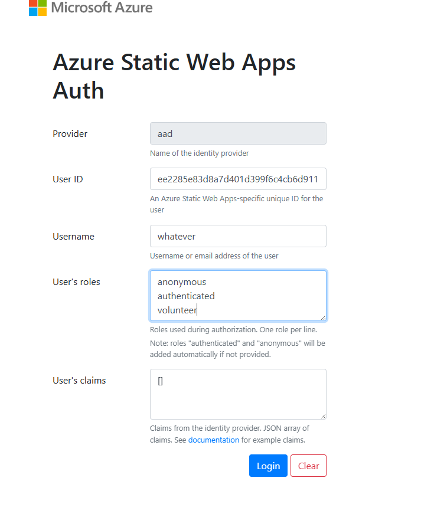

# Static Web App (SWA) Setup

## Overview

This project uses [Azure Static Web Apps](https://azure.microsoft.com/en-us/services/app-service/static/) to host the React frontend. The SWA CLI is used for local development to simulate the production environment.

## Prerequisites

- **Node.js and npm** v22 or later installed ([Download here](https://docs.npmjs.com/downloading-and-installing-node-js-and-npm))
- **Azure SWA CLI** - Installed automatically via npm dependencies
- **Database and DAB running** - See [database-setup.md](database-setup.md) and [DAB-setup.md](DAB-setup.md)
- **Azure Functions Core Tools v4** - `npm install -g azure-functions-core-tools@4`. Runs the Ask the Data Function, see [ask-the-data-setup.md](ask-the-data-setup.md)

## Local Development Workflow

1. **Ensure prerequisites are running:**
   - SQL Server database is running
   - DAB is running in a separate terminal: `dab start -c ./dab/dab-config.json`
   - Ask the Data Function is running in a separate terminal: `npm start --prefix api`

2. **Start SWA CLI:**
   ```bash
   swa start
   ```

3. **Access the application:**
   - Frontend: `http://localhost:4280`
   - DAB API: Connected via SWA proxy (configured in `swa-cli.config.json`)
   - Ask the Data API: `/api/ask-data`, proxied to the Function on port 7071

When you start SWA locally, you will get the logon screen below. In user name you can type anything you want.
You need to add **either** admin or volunteer to the User's roles. Without one of them, all API calls will fail.
With two of them, the app errors out. The Ask the Data card only answers `admin`.



## Configuration Files

### `swa-cli.config.json`

Configures the SWA CLI for local development:

```json
{
  "configurations": {
    "plymouth-housing": {
      "appLocation": ".",
      "outputLocation": "dist",
      "dataApiLocation": "swa-db-connections",
      "appBuildCommand": "npm run build",
      "run": "npm run dev",
      "appDevserverUrl": "http://localhost:3000",
      "apiDevserverUrl": "http://localhost:7071"
    }
  }
}
```

`apiDevserverUrl` tells the emulator to forward `/api` to the Function you started in step 1, instead of launching its own. If that terminal is not running, everything else still works and only the Ask the Data card fails.

## Additional Resources

- [Azure Static Web Apps Documentation](https://learn.microsoft.com/en-us/azure/static-web-apps/)
- [SWA CLI Documentation](https://azure.github.io/static-web-apps-cli/)
- [SWA Configuration Reference](https://learn.microsoft.com/en-us/azure/static-web-apps/configuration)
